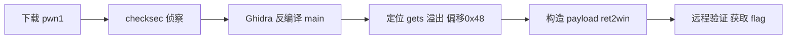

# ctf-demo — Final Report (Example)

> Report structure based on `skills/docs-generator/references/security-report-templates.md`.

## 1. Overview

| Item | Value |
|------|-------|
| Target | pwn1 (https://ctf.example.com/challenges/pwn1) |
| Type | CTF pwn (stack overflow) |
| Result | ✅ flag captured |
| Duration | ~1.5h |

## 2. Executive Summary

pwn1 is a 64-bit ELF with no PIE or canary; `main` uses `gets()` to read a 0x40-byte buffer.
The return address is overwritten at offset 0x48, then the program's `win` function is called to obtain the flag. Remote verification succeeded.

## 3. Timeline

See `timeline.md` (5 phases: init → recon → static → exploit → wrap).

## 4. Findings

### F-01

- title: gets() stack overflow in main (ret2win)
- severity: high
- status: validated
- confidence: high
- evidence_ids: [E-001, E-002, E-003]
- location: pwn1:main — gets() into buf[0x40], return offset 0x48, no canary
- impact: Remote code execution as the pwn1 process user; flag disclosure in CTF context.
- repro_steps:
  1. Triage the binary (E-001)
  2. Confirm the overflow offset with a cyclic/crash test (E-002)
  3. Send the ret2win payload against the remote service (E-003)
- remediation: Replace gets() with fgets/read; enable canary, PIE and full RELRO; rely on ASLR.

## 5. Attack Path (Evidence → Finding → Path)

### P-01

- title: pwn1 ret2win solve path
- path_type: solve
- start: challenge binary download
- goal: flag capture
- steps:
  1. action: download and triage pwn1 — evidence: E-001 — finding: F-01 | none
  2. action: decompile main and confirm gets() overflow — evidence: E-002 — finding: F-01
  3. action: craft ret2win payload and verify remotely — evidence: E-003 — finding: F-01
- residual_risks: none (isolated CTF lab)



## 6. Reproduction

```bash
python3 exploit.py REMOTE
```

## 7. Remediation Recommendations (If This Were a Real Application)

- Replace `gets` with `fgets`/`read`.
- Enable canary + PIE + full RELRO.
- Deploy ASLR on the server.

## 8. Notes

- The field-journal entry was sanitized (no real target information).
