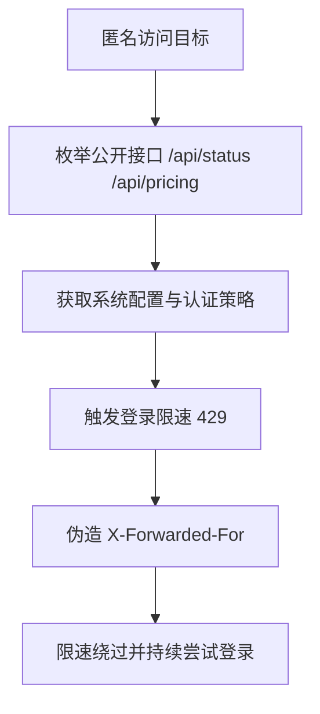

# Penetration Test Report: new.hahacc.com (CTF)

- Test date: 2026-05-26
- Target: `new.hahacc.com`
- Scope: Target domain and its exposed endpoints only
- Method: Passive information gathering, endpoint enumeration, and authentication and rate-limit validation

## Summary

Two categories of core issues were identified:

1. Login rate limiting can be bypassed by spoofing `X-Forwarded-For` (high severity).
2. Multiple unauthenticated endpoints expose sensitive system runtime configuration (medium severity).

## Finding 1: Login Rate-Limit Bypass (XFF Header Trust)

- Severity: High
- Affected endpoint: `POST /api/user/login`
- Description:
  The server appears to use a controllable request header (`X-Forwarded-For`) as a rate-limiting dimension without validating the trustworthiness of the proxy chain. An attacker can spoof or rotate XFF to bypass 429 rate limiting and make high-concurrency password attempts.

### Reproduction Commands (PoC)

```bash
# 1) 不带伪造头：触发限速
curl -k -s -o /dev/null -w "%{http_code}\n" \
  -H "Content-Type: application/json" \
  -X POST "https://new.hahacc.com/api/user/login?turnstile=" \
  --data '{"username":"root","password":"12345678"}'
# 结果：429

# 2) 带伪造 XFF：恢复可请求（绕过限速）
curl -k -s -o /dev/null -w "%{http_code}\n" \
  -H "Content-Type: application/json" \
  -H "X-Forwarded-For: 10.0.0.123" \
  -X POST "https://new.hahacc.com/api/user/login?turnstile=" \
  --data '{"username":"root","password":"12345678"}'
# 结果：200
```

### Evidence

- Consecutive requests without XFF: `429`
- Consecutive requests with rotating XFF: `200`

### Remediation

1. Trust only the real source IP supplied by the reverse proxy layer (for example, Nginx `real_ip` with a trusted proxy allowlist).
2. Base application-layer rate limits on a combination of trusted source address, account, and device fingerprint.
3. Strictly validate the source of `X-Forwarded-For` and prevent clients from overriding it directly.
4. Add delays after failed logins and account protection policies (sliding windows, exponential backoff, and escalating CAPTCHA challenges).

## Finding 2: Unauthenticated Sensitive Information Exposure (Status and Business Configuration)

- Severity: Medium
- Affected endpoints:
  - `GET /api/status`
  - `GET /api/pricing`
  - `GET /api/setup`
- Description:
  Unauthenticated users can retrieve complete system runtime configuration, feature flags, OAuth/Passkey parameters, group policies, and model and billing policies. This information can be used to map the attack surface precisely and optimize credential-stuffing strategies.

### Reproduction Commands (PoC)

```bash
curl -k -s https://new.hahacc.com/api/status
curl -k -s https://new.hahacc.com/api/pricing
curl -k -s https://new.hahacc.com/api/setup
```

### Examples of Exposed Fields

- `self_use_mode_enabled`
- `turnstile_check`
- `passkey_rp_id` / `passkey_origins`
- `supported_endpoint` / `group_ratio` / `usable_group`
- `setup` and `root_init` status fields

### Remediation

1. Move highly sensitive configuration to authenticated endpoints and return only the minimum fields needed for frontend display.
2. Allowlist fields returned by anonymous endpoints and deny internal configuration fields by default.
3. Apply access controls to the initialization status endpoint and minimize its response to prevent status inference.

## Attack Path Diagram



## Other Test Records

- Multiple open ports were identified (22/80/443/3000/3306/5000/5432/6379/8080/8443/9200/27017), but most service fingerprints were restricted and were not further exploited within this scope.
- Most endpoints in the batch probe were protected by authentication (401), indicating that core business functions retain basic access controls.

## Risk Conclusion

The primary risk is not direct unauthorized login, but bypassable brute-force protection combined with excessive anonymous information exposure. Used together, these issues can significantly reduce the cost of attack.

